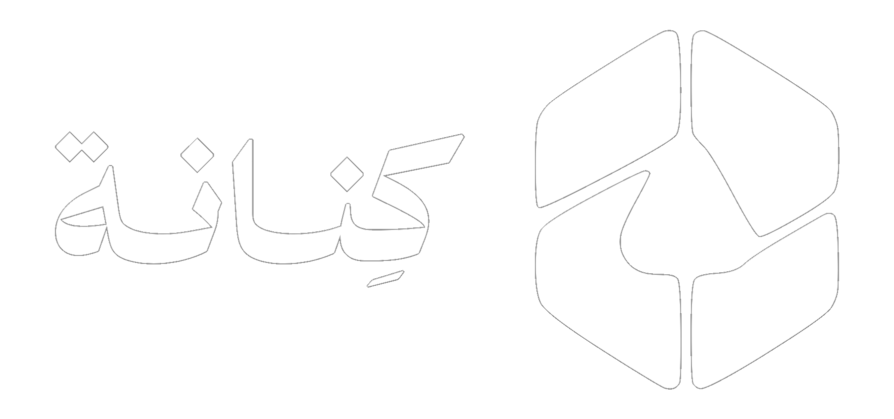

<div dir="rtl" align="center">



# كِنانة (Kinana)

**مدير كلمات مرور محلي وآمن لسطح المكتب**

مبني بلغة Rust وإطار العمل Tauri 2 مع واجهة React.

[](https://github.com/A-ALOSIME/kinana/releases)
[](https://github.com/A-ALOSIME/kinana/actions/workflows/ci.yml)
[](LICENSE)

[English](README.md) | [العربية](README.ar.md)

</div>

---

<div dir="rtl">

كنانة هو تطبيق مكتبي سريع ومستقل لإدارة كلمات المرور والبيانات الحساسة، مصمم لحماية الخصوصية والسيادة الكاملة على بياناتك. يشفر التطبيق بيانات الاعتماد والبطاقات المصرفية والملاحظات الحساسة محلياً بالكامل على جهازك باستخدام تشفير AES-256-GCM واشتقاق المفاتيح عبر Argon2id.

يعمل التطبيق دون أي اعتماد على خوادم سحابية، ودون أي تتبع للشبكة أو إرسال لأي بيانات أو إحصائيات خارجية، مما يضمن بقاء بياناتك ومفاتيح تشفيرك داخل جهازك الشخصي فقط.

---

## تنزيل التطبيق

حمّل أحدث إصدار مخصص لنظام تشغيلك:

| نظام التشغيل | المعمارية | صيغة الحزمة | رابط التنزيل | الحالة |
|---|---|---|---|---|
| **ويندوز (Windows)** | x86_64 (64-bit) | مثبت NSIS (`.exe`) | [kinana-windows-x64-setup.exe](https://github.com/A-ALOSIME/kinana/releases/latest/download/kinana-windows-x64-setup.exe) | مستقر (Stable) |
| **لينكس (Linux)** | x86_64 | حزمة دبيان / أوبونتو (`.deb`) | [kinana-linux-x64.deb](https://github.com/A-ALOSIME/kinana/releases/latest/download/kinana-linux-x64.deb) | مستقر (Stable) |
| **لينكس (Linux)** | x86_64 | حزمة مستقلة شاملة (`.AppImage`) | [kinana-linux-x64.AppImage](https://github.com/A-ALOSIME/kinana/releases/latest/download/kinana-linux-x64.AppImage) | مستقر (Stable) |
| **ماك (macOS)** | معالجات Apple Silicon (M1/M2/M3/M4) | صورة قرص (`.dmg`) | [kinana-macos-arm64.dmg](https://github.com/A-ALOSIME/kinana/releases/latest/download/kinana-macos-arm64.dmg) | تجريبي (Preview) |
| **ماك (macOS)** | معالجات Intel (x86_64) | صورة قرص (`.dmg`) | [kinana-macos-x64.dmg](https://github.com/A-ALOSIME/kinana/releases/latest/download/kinana-macos-x64.dmg) | تجريبي (Preview) |

للتحقق من سلامة وصحة الملفات المحملة، يمكنك مطابقة بصمة SHA-256 عبر ملف البصمات الرسمي:  
[SHA256SUMS.txt](https://github.com/A-ALOSIME/kinana/releases/latest/download/SHA256SUMS.txt)

> ملاحظة: حزم لينكس (DEB و AppImage) مصنفة كمستقرة بناءً على اختبارات بيئات التطوير والتوزيعات المعتمدة، دون ادعاء التوافق التام مع كافة توزيعات لينكس وتكوينات العتاد المختلفة. تظل إصدارات ماك (macOS) مصنفة كإصدارات تجريبية (Preview) في انتظار اكتمال الاختبارات اليدوية على أجهزة ماك. للاطلاع على خطوات التثبيت وتجاوز تنبيهات Windows SmartScreen أو Gatekeeper على ماك، يرجى مراجعة [دليل التثبيت](docs/installation.md).

---

## أبرز المزايا

- **تخزين محلي 100% دون إنترنت**: لا يعتمد التطبيق على أي خوادم سحابية، ولا يتصل بأي قواعد بيانات بعيدة، ولا يفتح أي منافذ شبكية. تظل بياناتك ومفاتيح تشفيرك على جهازك الشخصي فقط.
- **تشفير قياسي متين**: تشفير البيانات المتماثل باستخدام AES-256-GCM مع حماية البيانات الموثقة الإضافية (AAD)، واشتقاق المفاتيح عبر خوارزمية Argon2id بإعدادات أمان مرتفعة (64 ميجابايت ذاكرة، 3 تكرارات، 4 خيوط معالجة).
- **دعم كامل لـ 22 لغة عالمية**: توطين شامل للواجهة عبر 22 لغة، مع دعم أصيل للكتابة من اليمين إلى اليسار (RTL) للغات العربية والفارسية والعبرية والأردية بالإضافة إلى اللغات الأخرى.
- **إدارة الحسابات والبطاقات المصرفية**: حفظ بيانات المواقع والخدمات، أسماء المستخدمين، مفاتيح استرداد الحسابات (رموز استرداد 2FA)، البطاقات المصرفية (مدى، فيزا، ماستركارد، أمريكان إكسبريس)، رموز التحقق (CVV)، الأرقام السرية (PIN)، والملاحظات الآمنة.
- **مُولّد كلمات مرور وتحكم مستقل بالأسرار**: أداة مدمجة لتوليد كلمات مرور قوية وعشوائية مع خيارات لتخصيص الطول ومجموعات الرموز، مع أزرار نسخ وإظهار/إخفاء (عين) مستقلة تماماً لجميع حقول كلمات المرور والبطاقات.
- **قفل تلقائي ذكي عند الخمول**: قفل الخزنة تلقائياً بعد فترة عدم استخدام يحددها المستخدم (1، 5، 10، 15، 30، 60 دقيقة، أو مدة مخصصة)، مع تعليق المؤقت تلقائياً أثناء الكتابة النشطة داخل الحقول لتفادي مقاطعة العمل.
- **فتح تلقائي اختياري عبر النظام**: تكامل اختياري ومريح مع مستودعات الاعتماد الأصلية للنظام، مثل مدير الاعتمادات في ويندوز (Windows Credential Manager) أو خدمة الأسرار في لينكس (Linux Secret Service). (الفتح التلقائي غير مفعل حالياً على ماك حتى اكتمال التحقق من دعم Keychain).
- **دفتر معاملات آمن ضد الانهيار**: يعتمد التطبيق على نظام دفتر معاملات ذري (Write-Ahead Journal) مع نسخ استرجاع أمان تلقائية (`.vbak` و `.rbak`) لحماية بيانات الخزنة من التلف في حالات انقطاع الطاقة المفاجئ أو انهيار النظام.
- **مفتاح استرداد الطوارئ وإعادة ضبط الخزنة**: توليد مفتاح استرداد مشفر غير متصل بالإنترنت أثناء إنشاء الخزنة. وفي حال فقدان كل من كلمة المرور الرئيسية ومفتاح الاسترداد، تتيح ميزة **بدء خزنة جديدة** حذف الخزنة المحلية المحصورة بأمان للبدء من جديد.
- **تصدير واستيراد مشفر**: إمكانية إنشاء نسخ احتياطية محمولة مشفرة بصيغة `.dat` باستخدام كلمة المرور الرئيسية لنقل الخزنة بأمان بين أجهزتك المختلفة دون وسائط سحابية.
- **كفاءة واستهلاك خفيف للموارد**: نواة برمجية مدمجة بلغة Rust مدعومة بآلية تقليص مساحة العمل التلقائية (Working Set Trimming) عند التصغير أو القفل على نظام ويندوز، مما يخفض استهلاك الذاكرة في الخلفية إلى قرابة 42 ميجابايت كقيمة مقاسة للذاكرة العاملة في حالة الخمول (بينما يختلف الاستهلاك أثناء التشغيل الفعلي في الواجهة بحسب معالجة الرسوميات وشجرة العرض؛ راجع [docs/benchmarks.md](docs/benchmarks.md) للاطلاع على تفاصيل القياسات).
- **مجاني ومفتوح المصدر**: مرخص تحت رخصة MIT المرنة لضمان الشفافية وقابلية التدقيق البرمجي المستقل.

---

## نظرة عامة على الخصوصية والأمان

صُممت كنانة وفق مبدأ تقليل البيانات والدفاع المتعمق:

- **معمارية محلية فقط**: لا يفتح التطبيق أي منافذ شبكية ولا يجري أي طلبات إلى واجهات برمجية خارجية. لا توجد أي مزامنة سحابية أو تتبع للمستخدم أو إحصائيات خارجية.
- **مقايضات الفتح التلقائي ومستودعات الاعتماد**:
  - ميزة الفتح التلقائي اختيارية تماماً ومعطلة افتراضياً.
  - على ويندوز، تُحفظ الاعتمادات في Windows Credential Manager وتُحمى بواسطة DPAPI وتكون مقيدة بجلسة تسجيل دخول المستخدم.
  - على لينكس، تستخدم الميزة معيار Freedesktop Secret Service (عبر GNOME Keyring أو KWallet أو KeePassXC) عبر ناقل الجلسة D-Bus. يمكن لأي عملية تعمل بنفس معرّف المستخدم (UID) ولديها صلاحية الوصول إلى ناقل الجلسة الاستعلام عن هذه الخدمة؛ لذا يُنصح بإبقاء الفتح التلقائي معطلاً على الحسابات المشتركة.
  - على ماك، الفتح التلقائي غير مدعوم حالياً ويظل معطلاً.
- **أمان الحافظة (Clipboard Security)**:
  - على ويندوز، تُسجل عمليات النسخ صيغ استبعاد الحافظة (`ExcludeClipboardContentFromMonitorProcessing` و `CanIncludeInClipboardHistory = 0`) لتوجيه النظام بعدم تسجيل الأسرار في سجل حافظة ويندوز (Win+V) أو مزامنتها سحابياً. يُرجى ملاحظة أن أدوات إدارة الحافظة الخارجية أو برامج التقاط الشاشة أو البيئات المخترقة قد تتجاهل هذه الأعلام أو لا تدعمها، لذا لا يمكن ضمان منع تسجيل الحافظة شمولياً عبر كافة بيئات البرمجيات.
  - على جميع الأنظمة، يمسح التطبيق الأسرار المنسوخة تلقائياً من حافظة النظام بعد قرابة 15 ثانية.
  - على لينكس، تعمل برامج إدارة سجل الحافظة الخارجية المستقلة (مثل CopyQ أو GPaste أو Diodon أو Klipper) على رصد أحداث الحافظة وتخزين النصوص في قواعد بياناتها المستقلة. لا يمكن لعملية مسح الحافظة القياسية في X11/Wayland تعديل أو مسح السجلات التي التقطتها بالفعل تلك البرامج الخارجية؛ لذا يُنصح مستخدمو برامج إدارة الحافظة في لينكس بضبطها لاستبعاد النصوص الحساسة أو تعطيل السجل أثناء التعامل مع كلمات المرور.
- **حدود نموذج التهديدات**:
  - توفر كنانة حماية قوية ضد سرقة الأجهزة والتفتيش المادي للأقراص والعبث بملفات الخزنة المشفرة وهجمات التخمين دون اتصال.
  - لا يمكن للتطبيق حماية البيانات في حال وجود برمجيات خبيثة نشطة أو أدوات تسجيل ضربات المفاتيح (Keyloggers) أو أدوات قراءة الذاكرة أو اختراق على مستوى امتيازات النظام الأساسي (Root/Admin).
  - انعدام تام للنشاط الشبكي: لا يحتوي التطبيق على أي كود اتصالات شبكية، ولا يفتح أي منافذ استماع، ولا يجري أي طلبات شبكية خارجية، حيث تجري جميع العمليات محلياً وحصرياً على جهازك.
  - يعتمد أمان خزنتك بشكل أساسي على قوة كلمة المرور الرئيسية وحفظك الآمن لمفتاح استرداد الطوارئ، حيث لا يملك التطبيق أي أبواب خلفية لاستعادة البيانات.

---

## سلوك الاسترداد والنسخ الاحتياطي المحلي

### مفتاح استرداد الطوارئ
أثناء إنشاء الخزنة، تُولّد كنانة مفتاح استرداد طوارئ عالي العشوائية. إذا نسيت كلمة المرور الرئيسية، فإن هذا المفتاح هو الوسيلة المشفرة الوحيدة المتاحة لاستعادة الوصول إلى بيانات خزنتك. احرص على تدوينه والاحتفاظ به في مكان مادي آمن دون اتصال بالإنترنت (مثل كتابته على ورقة وحفظها في خزنة خاصة).

### بدء خزنة جديدة (Start a New Vault)
في حال فقدان كل من كلمة المرور الرئيسية ومفتاح استرداد الطوارئ، يصبح فك تشفير البيانات مستحيلاً رياضياً. لتمكينك من متابعة استخدام التطبيق دون الحاجة للبحث يدوياً عن مجلدات النظام وحذف ملفاتها، توفر كنانة خيار **بدء خزنة جديدة** داخل نافذة الاسترداد:

- **ليس استعادة لكلمة المرور**: هذا الإجراء لا يسترجع كلمة المرور المنسية ولا يفك تشفيرها.
- **التخلص من الخزنة المحلية**: يقوم الإجراء بحذف ملف الخزنة المحلي المقفل وسجل المعاملات والنسخ الاحتياطية المحلية القديمة عبر نظام الملفات ليتسنى لك إنشاء خزنة جديدة فارغة؛ ولا يزعم التطبيق إجراء محو فيزيائي مخصص لوسائط التخزين.
- **تأكيد كتابي صريح**: يتطلب الإجراء كتابة كلمة `RESET` بالأحرف اللاتينية الكبيرة للتأكيد قبل التنفيذ لمنع الحذف العرضي.
- **الحفاظ على النسخ الخارجية**: لا يتم حذف أو تعديل النسخ الاحتياطية المشفرة (`.dat`) التي سبق تصديرها وحفظها خارج مجلد التطبيق.
- **إجراء غير قابل للتراجع**: بمجرد التأكيد، يتم التخلص تماماً من ملفات الخزنة المحلية السابقة ولا يمكن استرجاعها أو فك تشفيرها.

### النسخ الاحتياطية المحمولة المشفرة (`.dat`)
نظراً لأن كنانة لا تعتمد على المزامنة السحابية، فإنك تحتفظ بالتحكم الكامل في نسخك الاحتياطية:
- يمكنك تصدير الخزنة في أي وقت عبر **الإعدادات** -> **النسخ الاحتياطي والتصدير** لإنشاء ملف `.dat` مشفر بخوارزمية AES-256-GCM.
- يمكن نقل هذا الملف بأمان بين أجهزتك المختلفة عبر وسائط التخزين (مثل أقراص USB) أو الشبكة المحلية، واستيراده باستخدام كلمة المرور الرئيسية.

---

## إرشادات التثبيت السريعة

### ويندوز (Windows - مستقر)
1. حمّل ملف التثبيت `kinana-windows-x64-setup.exe` مباشرة من صفحة [الإصدارات الرسمية على GitHub](https://github.com/A-ALOSIME/kinana/releases).
2. (يُوصى به) تحقق من مطابقة بصمة SHA-256 للمثبت عبر ملف [SHA256SUMS.txt](https://github.com/A-ALOSIME/kinana/releases/latest/download/SHA256SUMS.txt).
3. شغّل ملف التثبيت. نظراً لأن كنانة مشروع مستقل مفتوح المصدر وموزع دون شهادة توقيع برمجيات رقمية تجارية مدفوعة، قد يظهر تنبيه أمان Microsoft Defender SmartScreen بالعبارة ("Windows protected your PC") وفقاً لإعدادات سمعة الملف وسياسات النظام في نسختك من ويندوز. لا يعني عدم وجود توقيع رقمي أن الملف ضار، ولكن يجب دائماً التأكد من تحميله من مستودع GitHub الرسمي؛ وإذا عرض النظام الخيار، اضغط على **More info** ثم **Run anyway**. لا تقم مطلقاً بتعطيل حماية Windows Defender أو SmartScreen أو مضاد الفيروسات في نظامك.
4. اتبع معالج التثبيت لإتمام العملية.

### لينكس (Linux - مستقر)
- **أنظمة دبيان وأوبونتو ولينكس منت (`.deb`)**:
  ```bash
  sudo apt install ./kinana-linux-x64.deb
  ```
- **حزمة AppImage المستقلة (`.AppImage`)**:
  ```bash
  chmod +x kinana-linux-x64.AppImage
  ./kinana-linux-x64.AppImage
  ```

### ماك (macOS - تجريبي)
1. حمّل ملف `.dmg` المتوافق مع معالج جهازك ([Apple Silicon](https://github.com/A-ALOSIME/kinana/releases/latest/download/kinana-macos-arm64.dmg) أو [Intel](https://github.com/A-ALOSIME/kinana/releases/latest/download/kinana-macos-x64.dmg)).
2. افتح صورة القرص واسحب أيقونة **Kinana** إلى مجلد **Applications**. *(تنبيه هام: لا تفتح التطبيق بالنقر المزدوج عليه داخل صورة القرص مباشرة؛ فتح التطبيق مباشرة من صورة القرص للقراءة فقط يؤدي لرسالة خاطئة بأن التطبيق تالف، بل اسحبه أولاً إلى مجلد التطبيقات).*
3. قم بإخراج صورة القرص (Eject).
4. حزم ماك موقعة ذاتياً (ad-hoc signed عبر `codesign -s -`) لضمان سلامة الحزمة البرمجية داخلياً على معالجات Apple Silicon و Intel، ولكنها غير موقعة بشهادة تجارية مدفوعة من آبل وغير موثقة (Notarized). بالتالي، قد يعترض نظام Gatekeeper الفتح المباشر عند أول تشغيل:
   - **الطريقة الرسومية المفضلة**: افتح مجلد **Applications** في Finder، وانقر بزر الفأرة الأيمن (أو Control-click) على أيقونة **Kinana** واختر **Open**، ثم أكد بالضغط على **Open** في نافذة الحوار. (على إصدارات macOS الحديثة مثل Ventura وSonoma وSequoia، يمكنك أيضاً التوجه إلى **إعدادات النظام -> الخصوصية والأمان** والتمرير لأسفل والنقر على **Open Anyway**).
   - **خيار سطر الأوامر المتقدم**: يمكن للمستخدمين المتقدمين إزالة سمة الحجر الصحي المخصصة لحزمة التطبيق عبر Terminal:
     ```bash
     xattr -d com.apple.quarantine /Applications/Kinana.app
     ```
     *(ملاحظة: هذا الأمر يزيل سمة الحجر الصحي عن تطبيق كنانة تحديداً؛ لا تقم بتعطيل نظام Gatekeeper كلياً).*
5. بعد الترخيص، يعمل التطبيق بصورة طبيعية من مجلد التطبيقات أو عبر Spotlight.

للاطلاع على الإرشادات التفصيلية، راجع [دليل التثبيت](docs/installation.md).

---

## التطوير والبناء من المصدر (Building from Source)

### المتطلبات الأساسية
- [Rust](https://www.rust-lang.org/tools/install) (الإصدار المستقر Stable)
- [Node.js](https://nodejs.org/) (الإصدار 18 أو أحدث) مع مدير الحزم `npm`
- أدوات البناء البرمجية الخاصة بنظامك (Visual Studio Build Tools على ويندوز، أدوات Xcode على ماك، أو `build-essential` على لينكس)

### خطوات الإعداد

1. استنساخ المستودع:
   ```bash
   git clone https://github.com/A-ALOSIME/kinana.git
   cd kinana
   ```

2. تثبيت حزم الواجهة الأمامية:
   ```bash
   cd ui
   npm install
   cd ..
   ```

### التشغيل في وضع التطوير

- **تطبيق سطح المكتب الكامل (تطوير Tauri الأصلي)**:
  يشغّل خادم تطوير Vite وتطبيق سطح المكتب الأصلي Tauri مع تكامل كامل لكافة واجهات Rust الخلفية والتشفير وتكامل النظام:
  ```bash
  # عبر مختلف الأنظمة (باستخدام حزمة CLI المعتمدة في المشروع):
  npx --prefix ui tauri dev

  # على بيئة ويندوز (تشغيل مباشر للملف التنفيذي):
  .\ui\node_modules\.bin\tauri.cmd dev

  # على لينكس وماك (تشغيل مباشر للملف التنفيذي):
  ./ui/node_modules/.bin/tauri dev

  # في حال تثبيت tauri-cli عبر مدير حزم Cargo:
  cargo tauri dev
  ```

- **الواجهة الأمامية فقط (معاينة المتصفح)**:
  يشغّل خادم تطوير Vite فقط في المتصفح عبر `http://localhost:5173` لاختبار الواجهة دون واجهات سطح المكتب الخلفية:
  ```bash
  npm --prefix ui run dev
  ```

### تجميع النسخة الإنتاجية النهائية

لبناء الحزم التنفيذية المحسنة والمخصصة لنظام تشغيلك الحالي:
```bash
# عبر مختلف الأنظمة:
npx --prefix ui tauri build

# على بيئة ويندوز:
.\ui\node_modules\.bin\tauri.cmd build

# على لينكس وماك:
./ui/node_modules/.bin/tauri build

# أو عبر مدير حزم Cargo:
cargo tauri build
```

توجد الحزم والمثبتات المجمعة بعد اكتمال البناء في مجلد `target/release/bundle/`.

---

## الوثائق والأدلة التقنية

- [دليل التثبيت (Installation Guide)](docs/installation.md) - تعليمات التثبيت وحل المشكلات لجميع المنصات.
- [دليل البدء السريع (Getting Started)](docs/getting-started.md) - الإعداد لأول مرة، إضافة الحسابات، ومفتاح الاسترداد.
- [معمارية الأمان والتهديدات (Security Architecture)](docs/security.md) - خوارزميات التشفير، بنية ملف الخزنة، ونموذج التهديدات.
- [الأسئلة الشائعة (FAQ)](docs/faq.md) - إجابات الأسئلة المتكررة حول الأمان والاستخدام.
- [الأداء وقياسات الموارد (Performance & Benchmarks)](docs/benchmarks.md) - قياسات استهلاك الذاكرة وتخفيف الحزم.
- [سجل التغييرات (Changelog)](CHANGELOG.md) - تاريخ الإصدارات وسجل التحديثات.

---

## الإبلاغ عن الثغرات الأمنية

نولي أمان وخصوصية البيانات الأولوية القصوى. في حال اكتشافك لأي ثغرة أمنية، يرجى الإبلاغ عنها بسرية ومسؤولية باتباع الإرشادات الموضحة في [SECURITY.md](SECURITY.md)، وعدم فتح بلاغ عام على GitHub Issues.

---

## المساهمة في المشروع

نرحب بمساهمات المطورين واقتراحات التحسين والتبليغ عن الأخطاء البرمجية. يرجى قراءة [CONTRIBUTING.md](CONTRIBUTING.md) قبل فتح أي طلب سحب (Pull Request).

---

## الترخيص

هذا المشروع مرخص تحت رخصة [MIT](LICENSE).

</div>
